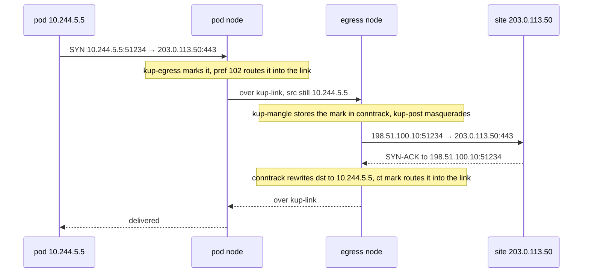

# Egress through a chosen node

Status: agreed with the admin on 2026-10-11 in conversation: an Egress kind and
an EgressClass kind beside PortMap and PortMapClass, one node per EgressClass,
pods selected by `podSelector`, failing closed when `failClosed: true`. Not
built yet.

## Goal

A pod's outbound connections leave the cluster from one chosen node's address.
The first user is the infra repo's qBittorrent on quasar's worker. It needs its
tracker announces, its outbound peer connections and mousehole's API calls to
leave from bar's public address, the address its PortMaps on `netcup-bar-w-1`
publish. Today a PortMap carries only connections a client opens and the
replies to them. Under `Single`, kup-mangle marks `ip saddr <pod ip> <proto>
sport <port>`, so a connection the pod opens from an ephemeral port goes out
Cilium's masquerade from quasar's own address.

Only pods an Egress selects change path. Every other pod keeps leaving through
Cilium's masquerade on its own node.

## API

```yaml
apiVersion: kuport.wlz.li/v1alpha1
kind: EgressClass
metadata:
  name: netcup-bar
spec:
  node: talos-netcup-bar-w-1
  namespaceSelector:
    matchLabels:
      kuport.wlz.li/egress: netcup-bar
  link:
    vni: 4400
    port: 4790
    subnet: 169.254.80.0/24
    subnet6: fd64:f5ac:e961::1:0/112
status:
  links: [...]        # LinkAllocation, as in PortMapClass
  nodes: [...]        # NodeStatus, as in PortMapClass
  conditions: [...]
---
apiVersion: kuport.wlz.li/v1alpha1
kind: Egress
metadata:
  name: qbittorrent
  namespace: media
spec:
  className: netcup-bar
  podSelector:
    matchLabels:
      app.kubernetes.io/name: qbittorrent
  failClosed: true
status:
  node: talos-netcup-bar-w-1
  pods:
    - name: qbittorrent-0
      node: talos-quasar-w-1
      address: 10.244.5.5
      address6: fd9f:6e92:f8f3:5::5
      path: Link        # Link, Local, Blocked or Direct
  conditions: [...]
```

### EgressClass

| Field | Meaning |
| --- | --- |
| spec.node | the egress node, where selected pods' traffic leaves the cluster. One node, required. Mutable: changing it moves every Egress of the class on the next pass |
| spec.namespaceSelector | which namespaces may reference the class. Empty selects every namespace, as in PortMapClass |
| spec.link | the VXLAN links' VNI base, UDP port, subnet and subnet6, the shape of PortMapClass's `returnPath.vxlan`. Defaults: VNI 4400, port 4790, `169.254.80.0/24`, `fd64:f5ac:e961::1:0/112` |
| status.links, status.nodes | the link claims and node rows, the types PortMapClass status already uses |

EgressClass has no `ports`, interface lists, `servingMode` or `returnPath.mode`.
Those describe how inbound traffic arrives on a PortMapClass, and an Egress
receives none.

The link defaults sit outside every range the infra repo uses today. PortMapClass
defaults to VNI 4242 and `169.254.77.0/24`; `netcup-bar-w-1-netbird` sets VNI
4250 and `169.254.78.0/24`; the steering stand-ins hold `169.254.76.0/24`. A
class's VNIs run from its base to base plus its slot count, 128 for a /24, so
4400 to 4527 overlaps neither 4242 to 4369 nor 4250 to 4377.

### Egress

| Field | Meaning |
| --- | --- |
| spec.className | an EgressClass. Immutable, for the reason PortMapSpec gives |
| spec.podSelector | pods in the Egress's namespace. Validation rejects an empty selector, which would select every pod in the namespace |
| spec.failClosed | optional, default false. True drops a selected pod's non-cluster traffic while its path through the egress node is down; false lets it leave from its own node. Mutable: the next pass swaps the rule |
| status.node | the class's `spec.node` |
| status.pods | every selected pod with an address, and which path its node programmed for it |

The Egress and the PortMap are independent. A pod can leave through bar with no
inbound port, and a PortMap gains no field.

Conditions reuse the PortMap reasons where they fit: `ClassNotFound`,
`NamespaceNotSelected`, `ReturnPathUnavailable`, `SubnetExhausted`,
`VxlanPortConflict`. Two new ones:

| Reason | When |
| --- | --- |
| `EgressConflict` | a selected pod is selected by an earlier Egress. The earliest `creationTimestamp`, then the name, wins, the order conflicts.go already uses for ports |
| `PodCIDRsUnknown` | a Node has no `spec.podCIDRs`, so the agents cannot build the set of cluster addresses. Every selected pod's path is down |

The egress node's agent writes the Egress status, as the serving node writes a
PortMap's. When `spec.node` names no Node, status falls to the first node in the
cluster by name.

## Prerequisite: marks and tables unique per node

`buildLinkParams` in internal/reconcile/links.go derives a link's packet mark and
routing table from its slot alone:

```go
mark:       markBase | uint32(slot),
table:      200 + uint32(slot),
```

A slot counts from 0 within one class. Two classes whose links end on the same
node therefore both claim mark `0x6b700000` and table 200 for their first link,
with a different default route each. The device name already includes the
class (`TestLinkNameIsPerClass`); the mark and the table do not. Going by the
code, the infra cluster can reach this today: `netcup-bar-w-1` and
`netcup-bar-w-1-netbird` both accept on bar, so a pod node holding the first
link of each class gets two default routes for table 200. Nobody has checked the
live tables for it. An EgressClass adds a third set of slots counting from 0.

The VNIs of those two infra classes overlap as well: `netcup-bar-w-1` runs from
4242 to 4369 and `netcup-bar-w-1-netbird` from 4250 to 4377, both on port 4790,
so slot 8 of the first and slot 0 of the second want VNI 4250 on bar. That
needs the slot count at 9 or more, and it is a fix to the infra inputs or to
kuport's validation, separate from this design.

A mark and a table only have to be unique on one node. The VXLAN header carries
neither, and each end of a link reads its own. The fix derives both from the link's
device name, which is already unique per class and peer:

```go
mark:  markBase | uint32(first 16 bits of sha256(class kind, class name, peer)),
table: the same value as the mark,
```

A table id is a 32-bit number, and `0x6b70xxxx` sits clear of the kernel's 253
to 255. Two links on one node whose 16 bits collide are refused: the later
claim by name reports `LinkConflict` on its class, and its mappings or Egresses
report `ReturnPathUnavailable`. The pref 101 and 102 rules, the routes and the
docs' ownership table in docs/development.md change with it.

This change ships on its own, before the Egress work, because it changes every
existing mark and table. The release rewrites them on each node's first pass,
which drops the return path of every in-flight connection that relies on a
conntrack mark under `Multi`.

The hash input includes the class kind, so an EgressClass and a PortMapClass
with the same name get different device names, marks and tables.

## Link

An EgressClass keeps its own link claims in its own status, in the types
PortMapClass uses. Its agents compute the needed pairs as
`pairKey(spec.node, pod node)` for every selected pod off the egress node, and
the agent on the pod's node proposes the claim, as it does for a mapping's
endpoint. The device name hashes the kind, the class name and the peer.

qBittorrent's PortMaps on `netcup-bar-w-1` and its Egress on `netcup-bar`
therefore build two VXLAN devices between bar and quasar's worker, one per
class. The kernel tells them apart by VNI. Release follows PortMapClass: a
pair no Egress needs gets `unusedSince`, and the claim is dropped 24 hours
later (docs/decisions.md, "Link release").

## Rules on the pod's node

A new chain, after kube-proxy's DNAT:

```
table inet kuport {
  set kup-cluster4 { type ipv4_addr; flags interval; elements = { <pod cidrs>, <node internal ips> } }
  set kup-cluster6 { type ipv6_addr; flags interval; elements = { <pod cidrs>, <node internal ips> } }

  chain kup-egress {
    type filter hook prerouting priority dstnat + 10; policy accept;
    # path Link
    meta nfproto ipv4 ip saddr <pod ip> ip daddr != @kup-cluster4 ct direction original counter meta mark set <link mark>
    # path Blocked, failClosed: true
    meta nfproto ipv4 ip saddr <pod ip> ip daddr != @kup-cluster4 ct direction original counter drop
    # path Direct, failClosed: false: no rule
    ...the ip6 forms with @kup-cluster6...
  }
}
```

```
ip rule  add pref 101 fwmark <mark> to <egress node address>/32 lookup main
ip rule  add pref 102 fwmark <mark> lookup <table>
ip route add default via <egress node's link address> dev <link> table <table>
```

The chain sits at `dstnat + 10` because kube-proxy translates a ClusterIP in nat
prerouting at -100. At kup-mangle's priority, `mangle + 10`, the destination of
a DNS query is still the CoreDNS ClusterIP, which no pod CIDR contains, and the
query would go to the egress node. After -100 it is the CoreDNS pod's address.
The kernel routes after the whole prerouting hook, so a mark set at -90 still
selects the pref 102 rule. The infra repo runs kube-proxy
(`kube_proxy_replacement: false`); with Cilium's socket load balancer the
ClusterIP never reaches netfilter and the priority makes no difference.

`ct direction original` keeps the rule to connections the pod opened. A reply to
a client that reached the pod through a PortMap keeps its reply direction and
leaves as it does today.

kup-cluster4 and kup-cluster6 hold every Node's `spec.podCIDRs` and its
InternalIP addresses. A selected pod's traffic to a netbird peer address is
outside both sets and leaves through the egress node like any other
destination.

kup-post claims the flow before Cilium's masquerade, as it does for a reply
today, without the port match:

```
oifname "kup-<link>" ip saddr <pod ip> counter snat ip to ip saddr
```

## Rules on the egress node

```
chain kup-mangle {
  ...
  iifname "kup-<link>" ct direction original counter ct mark set <link mark>
  ct direction reply ct mark <link mark> counter meta mark set ct mark
}

chain kup-post {
  ...
  iifname "kup-<link>" ct direction original counter masquerade
}
```

```
ip rule  add pref 101 fwmark <mark> to <pod node address>/32 lookup main
ip rule  add pref 102 fwmark <mark> lookup <table>
ip route add default via <pod node's link address> dev <link> table <table>
```

These mirror the pod node's rules for a reply under `Multi`. The first packet
of a flow from the link writes the link's mark into conntrack. A reply arriving
on ens3 restores the mark, the nat hook at -100 rewrites its destination back to
the pod, and the pref 102 rule routes it into the link. A reply to a request
that arrived on ens3 for a PortMap has a ct mark of 0 and keeps today's path.

The egress node writes these rules for a link only while an Egress selects a
pod on the link's other node. The masquerade matches no address, because the
pod node marks only selected pods.

A connection end to end, with the pod at `10.244.5.5`, bar's ens3 at
`198.51.100.10` and a site at `203.0.113.50`:



### kup-steer needs `ct direction original`

`masquerade` keeps the pod's source port when it is free on bar. A UDP flow
qBittorrent opens from 40000 then leaves bar from 40000, and its replies arrive
on ens3 with `udp dport 40000`. kup-steer, the chain qBittorrent's PortMap on
`netcup-bar-w-1` puts on bar, matches `iifname "ens3" udp dport 40000` with no
conntrack state and would rewrite their destination to a stand-in. Adding `ct
direction original` to every kup-steer rule leaves a client's packets untouched,
since a client always sends in the original direction, and skips the replies to
an egress flow. kup-pre is a nat chain and sees only a flow's first packet, so
it needs no change.

## MSS clamping

The link MTU is the underlay less 50, 1300 on the infra cluster, and Cilium
gives the pod the underlay's 1350. A TCP connection the pod opens would offer an
MSS the link cannot carry. Both ends of every link clamp a SYN leaving by it:

```
chain kup-mss {
  type filter hook forward priority mangle; policy accept;
  oifname "kup-*" tcp flags syn / syn,rst counter tcp option maxseg size set rt mtu
}
```

The pod's node clamps the pod's SYN, and the egress node clamps the remote
SYN-ACK. The clamp also covers PortMap flows, which today depend on
fragmentation or ICMP for TCP above 1300.

## When the path is down

The pod's node chooses the path for each selected pod from inputs every agent
shares, so the egress node writes the same path into status. Down means Blocked
under `failClosed: true` and Direct under `failClosed: false`:

| Inputs | Path |
| --- | --- |
| the pod runs on `spec.node` | Local: no rule, Cilium's masquerade on that node writes its address |
| the claim for the pair has landed, and the EgressClass status rows of the egress node and the pod's node are both ready | Link |
| the claim has not landed, or either row is not ready | down |
| the pod has an IPv6 address and the link has no /127, or either node has IPv6 forwarding off | IPv6 down, IPv4 decided by the rows above |
| a Node lacks `spec.podCIDRs` | down |
| a later Egress selects the pod too | the earlier Egress decides, its `failClosed` included |

A Direct pod's traffic goes out Cilium's masquerade from its own node's
address, as it would with no Egress. The condition `Programmed=False` with
reason `ReturnPathUnavailable` reports the down path either way.

The remaining failures and what a `failClosed: true` pod sees:

| Event | Effect |
| --- | --- |
| egress node powered off | nothing rewrites its row, so the pod node keeps marking. The link sends to a node that is down, and the packets are lost |
| egress node's agent restarts | its Teardown removes the link and the masquerade. VXLAN packets from the pod node reach no device and are dropped until the next agent's first pass |
| pod node's agent shuts down cleanly | Teardown replaces the table with one holding kup-egress and only its drop rules, for every pod on the node whose Egress sets `failClosed: true`. The next agent's first pass rewrites the table whole. With no such pod, Teardown removes the table as today |
| pod node's agent crashes | the rules stay, as for every other rule |
| the Egress is deleted | its rules go on the next pass, and the pod leaves from its own node. Deleting the Egress is the admin's choice to stop routing through the egress node |
| a new pod starts, or the pod node reboots | the pod sends from the moment its sandbox has an address. Until the agent's Pod watch delivers that address and the next pass runs, no rule matches it and it leaves from its own node. A reboot clears every nftables rule, so after one this applies to every selected pod on the node |

The last row is a window this design does not close. Neither the gap between a
sandbox getting its address and the agent's next pass nor the time qBittorrent
spends before its first announce has been measured.

Removing kuport while an Egress with `failClosed: true` exists leaves the drop
rules in place on every pod node until that node reboots. Delete the Egress
objects first.

Under `failClosed: false` every event in this table sends the pod's traffic out
from its own node until the path is back.

## Inputs

| Input | Source | Read by |
| --- | --- | --- |
| EgressClass, Egress | new watches | every agent |
| Pod | new watch, every agent, every namespace. A cache transform keeps the namespace, name, labels, `spec.nodeName`, `status.podIPs` and `deletionTimestamp`, and drops the rest. Pods in phase Succeeded or Failed are skipped | the pod's node for its rules, the egress node for status, every agent for the needed pairs |
| Node `spec.podCIDRs` | existing Node watch | every agent, for kup-cluster4 and kup-cluster6 |

The infra cluster runs Cilium with `ipam.mode: kubernetes`, which fills
`spec.podCIDRs`. Cilium's cluster-pool mode leaves it empty, and every Egress
then reports `PodCIDRsUnknown`.

The ClusterRole gains `get`, `list` and `watch` on pods, egressclasses and
egresses, and `update` and `patch` on egressclasses/status and egresses/status.

## Requirements of the cluster

The pod's outbound packets have to pass through the host's prerouting hook on
the pod's node, the same requirement the reply marking already has. The infra
repo's Cilium sets `bpf.hostLegacyRouting: true`. The app's
CiliumNetworkPolicy has to allow the pod's egress to the world; kuport changes
the route the packets take and leaves policy to Cilium.

## Not in scope

- Closing the window before the agent has seen a new pod's address. Closing it
  needs an init container in the app that waits for a signal from the pod
  node's agent naming the pod's current IP.
- Selecting pods through a Service.
- Per-destination exceptions, such as keeping the netbird range on the pod's
  own node.
- Failover to a second node. An EgressClass names one node; moving the traffic
  means editing `spec.node`.

## Tests

- Prerequisite: two classes with links on one node get distinct marks and
  tables; a forced 16-bit collision reports `LinkConflict` on the later class
  by name; an EgressClass and a PortMapClass with the same name get distinct
  device names.
- Goldens: kup-egress in both families with the Link and Blocked forms and the
  empty Direct form, the kup-cluster sets, the egress node's ct save, ct load
  and masquerade rules, kup-mss, and kup-steer with `ct direction original`.
- Reconcile: a pod on `spec.node` yields no rules and path Local; a pending
  claim yields Blocked under `failClosed: true` and Direct under false; flipping
  `failClosed` swaps the rule on the next pass; changing `spec.node` moves the
  link; two Egresses on one pod resolve to the earlier; an empty
  `spec.podCIDRs` yields `PodCIDRsUnknown` and a down path; a namespace outside
  the class's selector yields `NamespaceNotSelected`.
- Teardown: with a `failClosed: true` pod on the node, Teardown leaves a table
  holding only kup-egress drop rules; with none, it removes the table as today.
- Netlink: the egress node's pref 101 and 102 rules and its table route.
- On the cluster: a probe pod on quasar's worker with an Egress on an
  EgressClass naming bar fetches its public address from an address echo
  service and reads bar's. TCP and UDP, IPv4 and IPv6. Then, with bar's agent
  stopped and `failClosed: true`, the probe's fetch times out and never returns
  quasar's address; with `failClosed: false` it returns quasar's address.
