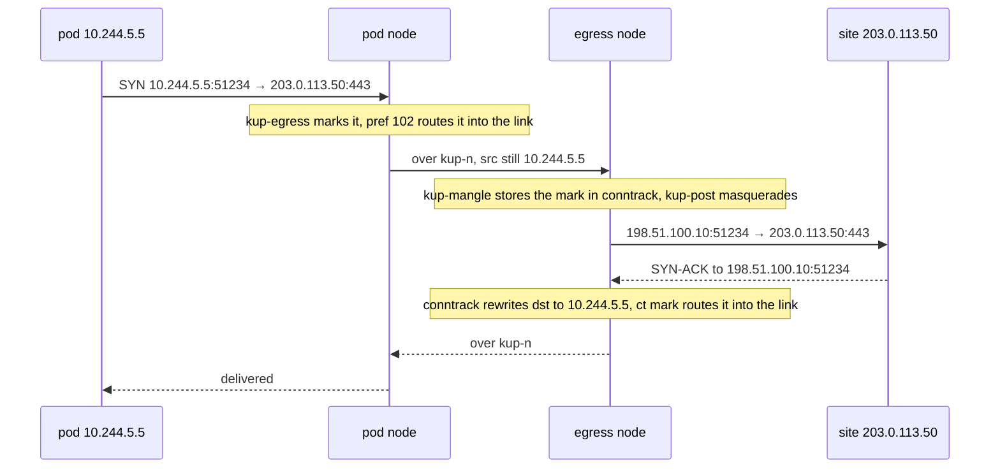

# Cluster-wide link allocation and egress

Status: agreed with the admin on 2026-10-11 in conversation. Two releases, in
this order:

1. Links: every return link gets its numbers from one cluster-wide pool of Link
   objects, which removes the per-class `vni`, `subnet` and `subnet6` settings
   and fixes the collisions and the claim release listed below.
2. Egress: an Egress kind and an EgressClass kind, one node per EgressClass,
   pods selected by `podSelector`, failing closed when `failClosed: true`.

Not built yet.

# Part 1: Links

## Goal

No two return links anywhere in the cluster share a VNI, a link address, a
packet mark or a routing table, whatever the classes set or leave at their
defaults. The admin sets none of these numbers.

## What is wrong today

Each PortMapClass stores its link claims in its own `status.links`, and a slot
counts from 0 within the class. `buildLinkParams` in internal/reconcile/links.go
derives every number from that slot:

```go
mark:       markBase | uint32(slot),
table:      200 + uint32(slot),
vni:        vni + uint32(slot),
// /31 and /127: the slot-th prefix of the class's subnet and subnet6
```

`docs/decisions.md` ("Link address allocation") says the recorded claim makes
"collisions impossible rather than handled". That holds inside one class, where
one status object arbitrates. Across classes nothing compares the numbers, and
`docs/datapath.md` hands the problem to the admin: "The class carries its own
vni and subnet because its accepting nodes overlap with public above".

On the infra cluster, read from the code and from the live class status on
2026-10-11:

| Fault | Where | Live today |
| --- | --- | --- |
| mark and table | every class's slot 0 uses `0x6b700000` and table 200. A node holding the first link of two classes gets two pref 102 rules for one mark and two default routes for table 200 | no: only `netcup-bar-w-1-netbird` holds claims |
| VNI | `quasar-w-1` and `netcup-bar-w-1` both default to 4242 on port 4790; `netcup-bar-w-1-netbird` runs 4250 to 4377. Two devices with one VNI and port on a node fail to create | no |
| subnet6 | all three classes use the default `fd64:f5ac:e961::/112`; the infra module has no `subnet6` input. Slot 0 of two classes puts one /127 on two devices | no |
| reserved tables | `200 + slot` is 253, 254 and 255 at slots 53 to 55, the kernel's default, main and local tables | no: the highest slot is 1 |
| claims never released | `gcClaims` stamps `unusedSince` on an unneeded claim, and `writeClass` passes it through `mergeClaim`, which clears `unusedSince` on every existing key. No claim has ever been released | yes: `netcup-bar-w-1-netbird` holds slot 0 (bar and quasar) and slot 1 (bar and ums), unused since librespeed's endpoint returned to bar; bar has no kup- device |

The claim leak keeps every slot a class has used reserved, so the other faults
come closer with every endpoint move.

## Link objects

A cluster-scoped kind. Its name is its slot:

```yaml
apiVersion: kuport.wlz.li/v1alpha1
kind: Link
metadata:
  name: slot-3
spec:
  classKind: PortMapClass        # or EgressClass
  className: netcup-bar-w-1
  peers: [talos-netcup-bar-w-1, talos-unraid-quasar-w-1]
status:
  unusedSince: null
```

The spec is immutable. `kubectl get links` prints the slot, the class and the
two peers.

### Claiming a slot

The agent holding the pod's end of a needed pair proposes the claim, the rule
kuport uses today. It reads the Link objects from its cache, picks the lowest
slot no Link holds, and creates `slot-<n>`. The API server refuses a second
create of the same name with `AlreadyExists`; the agent then requeues and picks
again on the next pass.

Two Links with the same class kind, class and peers can appear when an agent
creates one and its cache has not shown it before the next pass. Every agent
uses the lowest slot of the duplicates, and the proposing agent deletes the
others.

The pool holds 1024 slots. With every slot taken, the class reports
`SubnetExhausted`.

### Numbers derived from a slot

| Number | Slot n | Range for 1024 slots |
| --- | --- | --- |
| VNI | 7000 + n | 7000 to 8023 |
| UDP port | 4790 for every link, the agent flag `--link-port` | |
| IPv4 ends | the nth /31 of `169.254.64.0/21` | `169.254.64.0` to `169.254.71.255` |
| IPv6 ends | the nth /127 of `fd64:f5ac:e961::1:0/112` | the first 2048 addresses |
| mark | `0x6b700000 \| n` | |
| routing table | 1000 + n | 1000 to 2023 |
| device name | `kup-<n>` | `kup-0` to `kup-1023` |

The lower-named peer gets the low address of each pair, as today. The ranges
sit clear of everything kuport and the infra cluster use: the steering
stand-ins in `169.254.76.0/24`, the old class subnets `169.254.77.0/24` and
`169.254.78.0/24`, the old IPv6 default `fd64:f5ac:e961::/112`, the old VNIs
4242 to 4377, and the kernel's tables 253 to 255. Cilium's VXLAN listens on
8472, and `VxlanPortConflict` refuses a `--link-port` equal to the CNI's.

### Release

Every agent computes the needed pairs from the same inputs, so every agent may
write a Link's status. A Link no mapping or Egress needs gets `unusedSince`; a
needed Link with `unusedSince` has it cleared; any agent deletes a Link whose
`unusedSince` is more than 24 hours old, so a pair whose nodes are both gone is
still released. Each write is an update of one Link's status under its
resourceVersion; a conflict re-reads and recomputes. The 24-hour reservation and
its reasons stay as `docs/decisions.md` ("Link release") records them.

The release fault cannot recur in this form, because no merge step sits between
the computed `unusedSince` and the write. A reconcile test covers it: a Link
whose pair no mapping needs has `unusedSince` written on the first pass and is
deleted once it is 24 hours old.

## API changes

| Field | Change |
| --- | --- |
| PortMapClass `spec.returnPath.vxlan.vni`, `subnet`, `subnet6`, `port` | deprecated and ignored. The CRD keeps them for one release so an existing manifest still validates, and the class reports a `DeprecatedField` condition naming each one set |
| PortMapClass `status.links` | no longer written. Each accepting agent removes the field on its first pass |
| `returnPath.mode` | unchanged: `Vxlan` or `None` |

The PortMapClass `status.nodes` rows stay: each node still reports its
readiness and its MTU figures there, and both ends of a link still size the
device from the two rows.

## Upgrade

The first pass of the new agent on each node builds the links under their new
names and numbers and removes every `kup-<hash>` device, the pref 101 and 102
rules for the old marks, and the routes in tables 200 to 327, as objects under
kuport's names that the new State does not list. A connection through a
cross-node mapping that is open during that pass loses its return path once.
A mapping whose pod runs on its serving node has no link and is untouched.

The infra repo then drops `returnPath.vxlan` from its kuport module and the
`vxlan:` block from `netcup-bar-w-1-netbird` in environments/prod/networking/kuport/inputs.yaml.

## Docs

docs/decisions.md ("Link address allocation") gets the cluster-wide pool and the
reason the per-class store failed. docs/datapath.md loses the advice to give
overlapping classes their own `vni` and `subnet`. docs/development.md's
ownership table lists `kup-<n>`, tables 1000 to 2023 and marks `0x6b700000`
to `0x6b7003ff`. docs/api.md documents the Link kind.

# Part 2: Egress

## Goal

A pod's outbound connections leave the cluster from one chosen node's address.
The first user is the infra repo's qBittorrent on quasar's worker. It needs its
tracker announces, its outbound peer connections and mousehole's API calls to
leave from bar's public address, the address its PortMaps on `netcup-bar-w-1`
publish. A PortMap carries only connections a client opens and the replies to
them. Under `Single`, kup-mangle marks `ip saddr <pod ip> <proto>
sport <port>`, so a connection the pod opens from an ephemeral port goes out
Cilium's masquerade from quasar's own address.

Only pods an Egress selects change path. Every other pod keeps leaving through
Cilium's masquerade on its own node.

## API

```yaml
apiVersion: kuport.wlz.li/v1alpha1
kind: EgressClass
metadata:
  name: netcup-bar
spec:
  node: talos-netcup-bar-w-1
status:
  nodes: [...]        # NodeStatus, as in PortMapClass
  conditions: [...]
---
apiVersion: kuport.wlz.li/v1alpha1
kind: Egress
metadata:
  name: qbittorrent
  namespace: media
spec:
  className: netcup-bar
  podSelector:
    matchLabels:
      app.kubernetes.io/name: qbittorrent
  failClosed: true
status:
  node: talos-netcup-bar-w-1
  pods:
    - name: qbittorrent-0
      node: talos-quasar-w-1
      address: 10.244.5.5
      address6: fd9f:6e92:f8f3:5::5
      path: Link        # Link, Local, Blocked or Direct
  conditions: [...]
```

### EgressClass

| Field | Meaning |
| --- | --- |
| spec.node | the egress node, where selected pods' traffic leaves the cluster. One node, required. Mutable: changing it moves every Egress of the class on the next pass |
| spec.namespaceSelector | optional. Which namespaces may reference the class. Empty selects every namespace, as in PortMapClass |
| status.nodes | the egress node's row and a row for every node holding a selected pod, in the PortMapClass row type |

EgressClass has no link settings: its links come from the Link pool like a
PortMapClass's. It has no `ports`, interface lists or `servingMode`, which
describe how inbound traffic arrives on a PortMapClass.

### Egress

| Field | Meaning |
| --- | --- |
| spec.className | an EgressClass. Immutable, for the reason PortMapSpec gives |
| spec.podSelector | pods in the Egress's namespace. Validation rejects an empty selector, which would select every pod in the namespace |
| spec.failClosed | optional, default false. True drops a selected pod's non-cluster traffic while its path through the egress node is down; false lets it leave from its own node. Mutable: the next pass swaps the rule |
| status.node | the class's `spec.node` |
| status.pods | every selected pod with an address, and which path its node programmed for it |

The Egress and the PortMap are independent. A pod can leave through bar with no
inbound port, and a PortMap gains no field. A pod with both gets two links to
bar, one per class, each its own Link object.

Conditions reuse the PortMap reasons where they fit: `ClassNotFound`,
`NamespaceNotSelected`, `ReturnPathUnavailable`, `SubnetExhausted`. Two new
ones:

| Reason | When |
| --- | --- |
| `EgressConflict` | a selected pod is selected by an earlier Egress. The earliest `creationTimestamp`, then the name, wins, the order conflicts.go already uses for ports |
| `PodCIDRsUnknown` | a Node has no `spec.podCIDRs`, so the agents cannot build the set of cluster addresses. Every selected pod's path is down |

The egress node's agent writes the Egress status, as the serving node writes a
PortMap's. When `spec.node` names no Node, status falls to the first node in the
cluster by name.

## Link

The needed pairs of an EgressClass are `(spec.node, pod node)` for every
selected pod off the egress node, with `classKind: EgressClass`. The agent on the
pod's node proposes the Link, as for a mapping's endpoint.

## Rules on the pod's node

A new chain, after kube-proxy's DNAT:

```
table inet kuport {
  set kup-cluster4 { type ipv4_addr; flags interval; elements = { <pod cidrs>, <node internal ips> } }
  set kup-cluster6 { type ipv6_addr; flags interval; elements = { <pod cidrs>, <node internal ips> } }

  chain kup-egress {
    type filter hook prerouting priority dstnat + 10; policy accept;
    # path Link
    meta nfproto ipv4 ip saddr <pod ip> ip daddr != @kup-cluster4 ct direction original counter meta mark set <link mark>
    # path Blocked, failClosed: true
    meta nfproto ipv4 ip saddr <pod ip> ip daddr != @kup-cluster4 ct direction original counter drop
    # path Direct, failClosed: false: no rule
    ...the ip6 forms with @kup-cluster6...
  }
}
```

```
ip rule  add pref 101 fwmark <mark> to <egress node address>/32 lookup main
ip rule  add pref 102 fwmark <mark> lookup <table>
ip route add default via <egress node's link address> dev kup-<n> table <table>
```

The chain sits at `dstnat + 10` because kube-proxy translates a ClusterIP in nat
prerouting at -100. At kup-mangle's priority, `mangle + 10`, the destination of
a DNS query is still the CoreDNS ClusterIP, which no pod CIDR contains, and the
query would go to the egress node. After -100 it is the CoreDNS pod's address.
The kernel routes after the whole prerouting hook, so a mark set at -90 still
selects the pref 102 rule. The infra repo runs kube-proxy
(`kube_proxy_replacement: false`); with Cilium's socket load balancer the
ClusterIP never reaches netfilter and the priority makes no difference.

`ct direction original` keeps the rule to connections the pod opened. A reply to
a client that reached the pod through a PortMap keeps its reply direction and
leaves as it does today.

kup-cluster4 and kup-cluster6 hold every Node's `spec.podCIDRs` and its
InternalIP addresses. A selected pod's traffic to a netbird peer address is
outside both sets and leaves through the egress node like any other
destination.

kup-post claims the flow before Cilium's masquerade, as it does for a reply
today, without the port match:

```
oifname "kup-<n>" ip saddr <pod ip> counter snat ip to ip saddr
```

## Rules on the egress node

```
chain kup-mangle {
  ...
  iifname "kup-<n>" ct direction original counter ct mark set <link mark>
  ct direction reply ct mark <link mark> counter meta mark set ct mark
}

chain kup-post {
  ...
  iifname "kup-<n>" ct direction original counter masquerade
}
```

```
ip rule  add pref 101 fwmark <mark> to <pod node address>/32 lookup main
ip rule  add pref 102 fwmark <mark> lookup <table>
ip route add default via <pod node's link address> dev kup-<n> table <table>
```

These mirror the pod node's rules for a reply under `Multi`. The first packet
of a flow from the link writes the link's mark into conntrack. A reply arriving
on ens3 restores the mark, the nat hook at -100 rewrites its destination back to
the pod, and the pref 102 rule routes it into the link. A reply to a request
that arrived on ens3 for a PortMap has a ct mark of 0 and keeps today's path.

The egress node writes these rules for a link only while an Egress selects a
pod on the link's other node. The masquerade matches no address, because the
pod node marks only selected pods.

A connection end to end, with the pod at `10.244.5.5`, bar's ens3 at
`198.51.100.10` and a site at `203.0.113.50`:



### Replies on a mapped port: tested before anything changes

`masquerade` keeps the pod's source port when it is free on bar. A UDP flow
qBittorrent opens from 40000 then leaves bar from 40000, and its replies arrive
on ens3 with `udp dport 40000`. kup-steer, the chain qBittorrent's PortMap on
`netcup-bar-w-1` puts on bar, matches `iifname "ens3" udp dport 40000` with no
conntrack state, so it rewrites those replies' destination to a stand-in.

Whether that breaks the reply is not known. Conntrack has matched the reply to
the egress flow at -200, before kup-steer runs, and the nat hook at -100 writes
the destination from the conntrack tuple, which is the pod's address. If it
overwrites the stand-in, the reply arrives and kup-steer needs no change. The
same question exists today without an Egress: a pod on its PortMap's accepting
node that opens a flow from its mapped port leaves through Cilium's masquerade
with that port, and its replies meet kup-steer the same way.

kup-steer stays as it is, and a kernel test decides:

- In internal/datapath/firewall_kernel_test.go, beside
  `TestDeliversThroughHostFirewallOnRealKernel` and in the same three
  namespaces with the same copy of Talos's firewall chain, the pod opens a flow
  to the client namespace from its mapped UDP port and from its mapped TCP port,
  in IPv4 and IPv6. The node loads the mapping's kup-steer and kup-pre rules
  for those ports and masquerades the pod's flow out the uplink, so the reply
  arrives with the mapped port as its destination port.
- The test asserts that the client sees the node's uplink address as the
  source and that the pod receives every reply.

If the test passes, kup-steer is unchanged and docs/datapath.md records the
measurement. If it fails, the test keeps `nft monitor trace` output for the
dropped reply, and the narrowest fix the trace points at goes into this spec
and docs/datapath.md with that trace, before the Egress code depends on it.

## MSS clamping

The link MTU is the underlay less 50, 1300 on the infra cluster, and Cilium
gives the pod the underlay's 1350. A TCP connection the pod opens would offer an
MSS the link cannot carry. Both ends of every link clamp a SYN leaving by it:

```
chain kup-mss {
  type filter hook forward priority mangle; policy accept;
  oifname "kup-*" tcp flags syn / syn,rst counter tcp option maxseg size set rt mtu
}
```

The pod's node clamps the pod's SYN, and the egress node clamps the remote
SYN-ACK. The clamp also covers PortMap flows, which today depend on
fragmentation or ICMP for TCP above 1300.

## When the path is down

The pod's node chooses the path for each selected pod from inputs every agent
shares, so the egress node writes the same path into status. Down means Blocked
under `failClosed: true` and Direct under `failClosed: false`:

| Inputs | Path |
| --- | --- |
| the pod runs on `spec.node` | Local: no rule, Cilium's masquerade on that node writes its address |
| the pair's Link exists, and the EgressClass status rows of the egress node and the pod's node are both ready | Link |
| no Link yet, or either row is not ready | down |
| the pod has an IPv6 address and the link carries no IPv6, or either node has IPv6 forwarding off | IPv6 down, IPv4 decided by the rows above |
| a Node lacks `spec.podCIDRs` | down |
| a later Egress selects the pod too | the earlier Egress decides, its `failClosed` included |

A Direct pod's traffic goes out Cilium's masquerade from its own node's
address, as it would with no Egress. The condition `Programmed=False` with
reason `ReturnPathUnavailable` reports the down path either way.

The remaining failures and what a `failClosed: true` pod sees:

| Event | Effect |
| --- | --- |
| egress node powered off | nothing rewrites its row, so the pod node keeps marking. The link sends to a node that is down, and the packets are lost |
| egress node's agent restarts | its Teardown removes the link and the masquerade. VXLAN packets from the pod node reach no device and are dropped until the next agent's first pass |
| pod node's agent shuts down cleanly | Teardown replaces the table with one holding kup-egress and only its drop rules, for every pod on the node whose Egress sets `failClosed: true`. The next agent's first pass rewrites the table whole. With no such pod, Teardown removes the table as today |
| pod node's agent crashes | the rules stay, as for every other rule |
| the Egress is deleted | its rules go on the next pass, and the pod leaves from its own node. Deleting the Egress is the admin's choice to stop routing through the egress node |
| a new pod starts, or the pod node reboots | the pod sends from the moment its sandbox has an address. Until the agent's Pod watch delivers that address and the next pass runs, no rule matches it and it leaves from its own node. A reboot clears every nftables rule, so after one this applies to every selected pod on the node |

The last row is a window this design does not close. Neither the gap between a
sandbox getting its address and the agent's next pass nor the time qBittorrent
spends before its first announce has been measured.

Removing kuport while an Egress with `failClosed: true` exists leaves the drop
rules in place on every pod node until that node reboots. Delete the Egress
objects first.

Under `failClosed: false` every event in this table sends the pod's traffic out
from its own node until the path is back.

## Inputs

| Input | Source | Read by |
| --- | --- | --- |
| EgressClass, Egress | new watches | every agent |
| Pod | new watch, every agent, every namespace. A cache transform keeps the namespace, name, labels, `spec.nodeName`, `status.podIPs` and `deletionTimestamp`, and drops the rest. Pods in phase Succeeded or Failed are skipped | the pod's node for its rules, the egress node for status, every agent for the needed pairs |
| Node `spec.podCIDRs` | existing Node watch | every agent, for kup-cluster4 and kup-cluster6 |

The infra cluster runs Cilium with `ipam.mode: kubernetes`, which fills
`spec.podCIDRs`. Cilium's cluster-pool mode leaves it empty, and every Egress
then reports `PodCIDRsUnknown`.

The ClusterRole gains `get`, `list` and `watch` on pods, egressclasses and
egresses, and `update` and `patch` on egressclasses/status and egresses/status.
Part 1 adds `get`, `list`, `watch`, `create` and `delete` on links and `update`
and `patch` on links/status.

## Requirements of the cluster

The pod's outbound packets have to pass through the host's prerouting hook on
the pod's node, the same requirement the reply marking already has. The infra
repo's Cilium sets `bpf.hostLegacyRouting: true`. The app's
CiliumNetworkPolicy has to allow the pod's egress to the world; kuport changes
the route the packets take and leaves policy to Cilium.

## Not in scope

- Closing the window before the agent has seen a new pod's address. Closing it
  needs an init container in the app that waits for a signal from the pod
  node's agent naming the pod's current IP.
- Selecting pods through a Service.
- Per-destination exceptions, such as keeping the netbird range on the pod's
  own node.
- Failover to a second node. An EgressClass names one node; moving the traffic
  means editing `spec.node`.

# Tests

## Part 1

- Allocation: two classes with links on one node get distinct VNIs, /31s,
  /127s, marks and tables; slot 53 yields table 1053; a create that returns
  `AlreadyExists` requeues and creates the next free slot; two Links for one pair
  resolve to the lower slot and the proposer deletes the other; 1024 Links
  yield `SubnetExhausted`.
- Release: an unneeded Link gets `unusedSince` on the first pass, a needed one
  has it cleared, one unused for more than 24 hours is deleted by any agent.
- Upgrade: a node holding `kup-<hash>` devices, tables 200 and up and the old
  marks ends its first pass holding only `kup-<n>` objects; a PortMapClass with
  `status.links` has the field removed; a class setting `vni` reports
  `DeprecatedField`.
- On the cluster: after the release, `kubectl get links` shows one Link per
  cross-node pair, each node's `ip rule` lists only marks `0x6b7000xx` with
  tables 1000 and up, and the udp-echo probe crosses nodes as before.

## Part 2

- Kernel, first: the reply to a pod's flow masqueraded from its mapped port
  reaches the pod through kup-steer, as "Replies on a mapped port" describes.
  Its result decides whether kup-steer changes.
- Goldens: kup-egress in both families with the Link and Blocked forms and the
  empty Direct form, the kup-cluster sets, the egress node's ct save, ct load
  and masquerade rules, and kup-mss.
- Reconcile: a pod on `spec.node` yields no rules and path Local; a missing
  Link yields Blocked under `failClosed: true` and Direct under false; flipping
  `failClosed` swaps the rule on the next pass; changing `spec.node` moves the
  link; two Egresses on one pod resolve to the earlier; an empty
  `spec.podCIDRs` yields `PodCIDRsUnknown` and a down path; a namespace outside
  the class's selector yields `NamespaceNotSelected`.
- Teardown: with a `failClosed: true` pod on the node, Teardown leaves a table
  holding only kup-egress drop rules; with none, it removes the table as today.
- Netlink: the egress node's pref 101 and 102 rules and its table route.
- On the cluster: a probe pod on quasar's worker with an Egress on an
  EgressClass naming bar fetches its public address from an address echo
  service and reads bar's. TCP and UDP, IPv4 and IPv6. Then, with bar's agent
  stopped and `failClosed: true`, the probe's fetch times out and never returns
  quasar's address; with `failClosed: false` it returns quasar's address.
