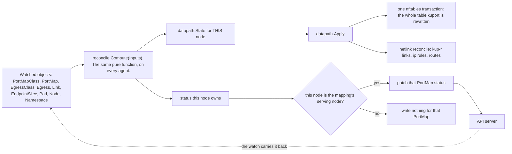
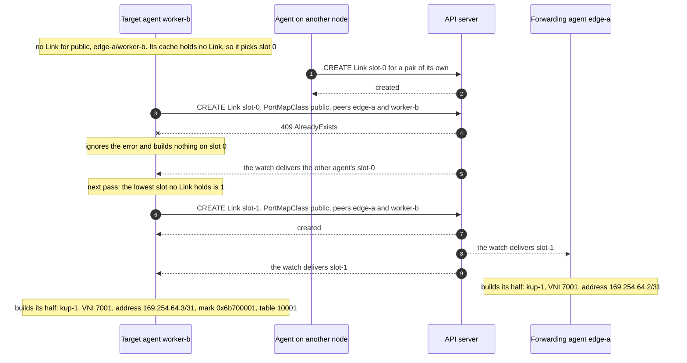

# Architecture

One DaemonSet. Each pod watches the API and programs the node it is on. There is
no central controller and no leader election.

```
PortMapClass ─┐
PortMap ──────┤
EndpointSlice ┤
EgressClass ──┼─→ agent on each node ─→ desired ruleset for THIS node ─→ nftables
Egress ───────┤                      └─→ desired links and routes ────→ netlink
Pod ──────────┤
Link ─────────┘
```

Every agent computes from the same inputs with the same deterministic
tie-breaks, so they agree without talking to each other. An endpoint moving
changes the input on every agent at once, through the same watch.



Every agent runs the computation; the picture is one node's pass. Two agents
reaching different conclusions would program different pods, which is why every
tie-break in Compute is deterministic rather than negotiated.

## The reconcile

The reconcile is level-driven. Each pass builds the complete desired state for
this node and applies it in one nftables transaction, so a mapping that was
deleted disappears by being absent rather than by anything remembering to
remove it.

Every agent resolves every PortMap from the same shared inputs, then emits only
the objects this node owns.

Resolution:

1. Resolve serviceRef to the ready IPv4 endpoints of the named port, each with
   the number the EndpointSlice lists for it: the port the pod receives on.
2. Choose one. Candidates on an accepting node rank above all others, ordered by
   accepting-node name and then by pod name within a node; with no candidate on
   an accepting node, the ready candidate with the smallest pod name wins. No
   input describes where the agent runs, so every agent picks the same endpoint.
3. Fix the serving node: the chosen endpoint's node when that node accepts the
   class, otherwise the first accepting node by name.
4. Look the chosen pod up in the Service's IPv6 EndpointSlice by its targetRef.
   When the pod is there and ready, and this node forwards IPv6, every rule
   below that carries an address is emitted once more in IPv6.

Under `Single` exactly one node serves each mapping. Under `Multi` every
accepting node programs it and the serving node keeps its separate job of
writing status. [Serving modes](datapath.md#serving-modes) has the difference.

Emission on a node that accepts the mapping:

1. A DNAT rule per interface in the class. A pod on this node is translated
   straight to, on the pod's port; a pod elsewhere is translated to the far end
   of this node's own return link, keeping the port the client dialed.
2. The masquerade exemption for the inbound leg, following the device the packet
   leaves by.
3. When the chosen pod is on another node, this end of the return link, once
   the pair's Link object is in this agent's cache.

Emission on the node holding the chosen pod, when another node forwards to it:

1. This end of each return link.
2. A DNAT rule per link, completing the translation to the pod's address and
   port.
3. The return marking, the routing rules and the table entries.
4. The masquerade exemption for the reply.

Every other node emits nothing for the mapping.

## Status writing

The mapping's serving node writes its PortMap status; every other agent writes
none for that mapping. That gives exactly one writer per PortMap without leader
election, and it changes hands when the endpoint or the accepting set moves. A
refused or endpoint-less mapping has no serving node, so its status falls to the
chosen endpoint's node, else the first accepting node by name, else the first
node in the cluster: one writer in every case.

The class status is written by the class's accepting nodes alone. Each one
writes its own `nodes` row and the class conditions, which every accepting node
computes the same way. A node that only holds a mapping's pod writes nothing to
the class.

An Egress follows the same rule with the egress node in the serving node's
place: the egress node's agent writes the Egress status, and when the class
names no Node, the first node in the cluster by name writes it. An EgressClass
gets a `nodes` row from every node taking part, the egress node and each node
holding a selected pod. Every agent decides each selected pod's path from the
same Links and rows, so the path the egress node reports is the path the pod's
node programmed. The agent creating a Link for an Egress is the one on the
selected pod's node.

Every agent caches every Pod for this, stripped to the fields the Egress
reconcile reads: name, namespace, labels, node, phase, pod IPs and deletion. A
Pod update starts a pass only when one of those changed.

A return link's slot lives in a cluster-scoped Link object named `slot-<n>`.
The agent holding a mapping's pod creates the Link for each pair it needs: it
reads the Links in its cache, picks the lowest slot none of them holds, and
creates that name. When two agents pick the same slot, the API server accepts
the first create and answers the second with AlreadyExists. The second agent
ignores the error; the watch brings the winner's Link into its cache, and its
next pass picks another slot. Every agent proposes slots for its missing pairs
in sorted order of class and node names, so two agents with the same cache
propose the same slots.

No agent builds the mark, the divert rules, the device or the routes of a slot
until that slot's Link is in its cache, so a slot whose create the API server
refused never marks a packet.

A holder whose cache has not yet shown its own create can create a second Link
for the same pair on another slot. Every agent uses the lower slot, and the
holder deletes the other Link.

For a remote pod the forwarding node waits on the pod's node, because the Link
for their pair is created there. Until the Link reaches the forwarding node's
cache, the mapping reports `Programmed=False` with reason
`ReturnPathUnavailable` and the message `return link for edge-a/worker-b is not
claimed yet`. Links are watched, so the next pass sees the new Link and the
condition clears.



The slot settles the whole derivation: the /31 ends are fixed by the sorted
node names, so both halves compute each other's address from the Link's name
and exchange nothing else. [api.md](api.md#link) lists every number a slot
fixes and which agent may update or delete a Link.
