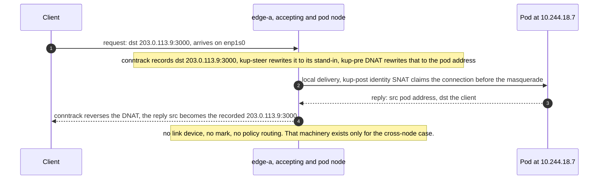
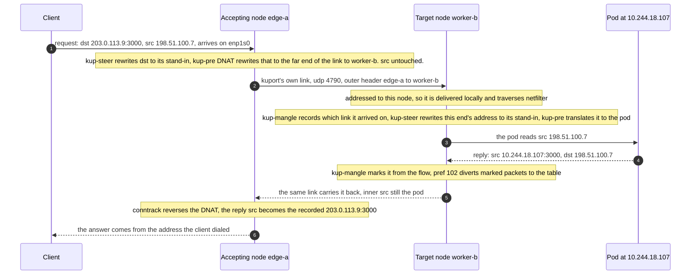
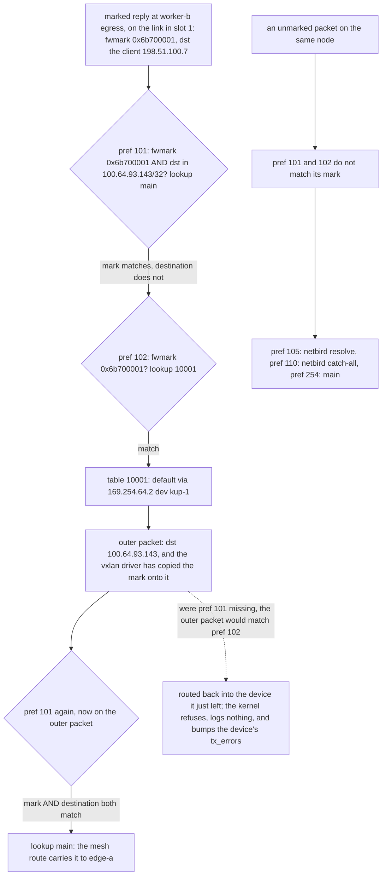
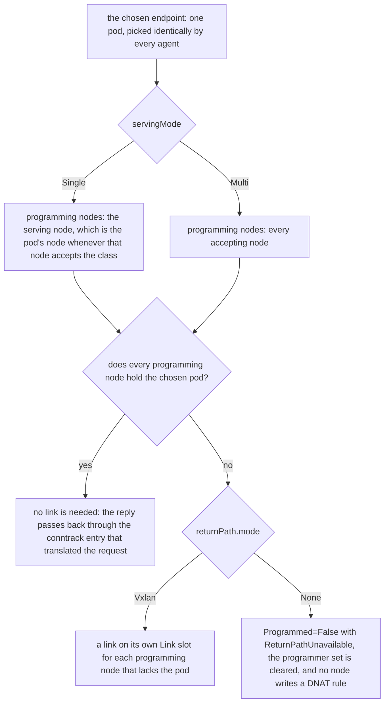
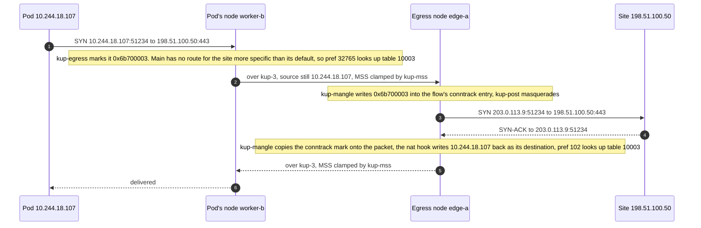

# Datapath

Every IPv4 rule here carried real traffic on a live cluster before it was
written down, and each one names the measurement that confirmed it. Several of
them contradict what the documentation suggests, which is why the measurements
stay. The IPv6 rules in [IPv6](#ipv6) have been loaded into a kernel by the
datapath tests and have not yet carried traffic on a cluster. The steering
rules in [Host firewall](#host-firewall) carried TCP and UDP in both families
through copies of Talos's firewall chain and netbird's rules in the datapath
tests' network namespaces. On a live cluster they have carried IPv4 TCP and
UDP through Talos's firewall on a node's public interface, and IPv4 TCP over
netbird's wt0 on another node.

Two shapes cover everything: the pod sits on the node that accepted the packet,
or it does not.

## Same node



## Cross node



Both legs ride kuport's own link since v0.4.0. Before that the request travelled
the CNI's tunnel while only the reply used the link, which tied the design to
Cilium's routing mode and made `Multi` impossible.
[The decision](decisions.md#carrying-both-legs-on-kuports-own-link) records why
it changed and what measurement forced it.

Routing by default from worker-b would send the reply out worker-b's own
internet connection with the pod address as source, and the client's firewall
discards it as spoofed. The link is what stops that.

## Why the destination is translated twice

WireGuard accepts a decrypted packet only when its source falls inside the
allowed IPs of the peer that sent it, and a mesh gives each peer a single /32. A
forwarded packet keeping the client's source is discarded inside WireGuard,
before netfilter, so no nftables rule on either node can rescue it.

Measured: with a NodePort target, the accepting node translated and forwarded,
and every counter on the target node stayed at zero. The packet was gone before
prerouting.

An encapsulation is what fixes it. The outer header carries the two nodes' own
addresses, WireGuard accepts it, and the inner packet reaches the far side with
the client's source intact. Measured: 54ms round trip, cross-node, client address
preserved.

The accepting node therefore translates to something reachable over the link
rather than to the pod, and the far side finishes the job. Two translations, each
reversed by its own node's conntrack, and neither touches the source.

Going to an address rather than a NodePort also removes two problems. There is
no second port number from the 30000-32767 range for people to know about, and
there is no second DNAT. That matters, because a packet is destination-NATed once
per netfilter hook: an accepting node that DNATs to its own NodePort makes
kube-proxy's rules a no-op. Measured: the DNAT counter climbed, conntrack showed
the node address as the reply source rather than the pod's, and the pod never saw
the packet.

## Rules on an accepting node

```
table inet kuport {
  map kup-steer4 {
    type ipv4_addr : ipv4_addr
    elements = { <node address> : <stand-in>, ...one per address the node holds... }
  }
  ...kup-steer6 for IPv6...

  chain kup-steer {
    type filter hook prerouting priority dstnat - 20; policy accept;
    meta nfproto ipv4 iifname "<iface>" <proto> dport <port> ip daddr set ip daddr map @kup-steer4 counter
    meta nfproto ipv6 iifname "<iface>" <proto> dport <port> ip6 daddr set ip6 daddr map @kup-steer6 counter
    ...one per interface per family per mapping...
  }

  chain kup-pre {
    type nat hook prerouting priority dstnat - 20; policy accept;
    meta nfproto ipv4 iifname "<iface>" <proto> dport <port> counter dnat ip to <target>:<target port>
    meta nfproto ipv6 iifname "<iface>" <proto> dport <port> counter dnat ip6 to [<target6>]:<target port>
    ...one per interface per family per mapping...
  }

  chain kup-post {
    type nat hook postrouting priority srcnat - 10; policy accept;
    oifname "<egress dev>" ip daddr <target> <proto> dport <target port> counter snat ip to ip saddr
    oifname "<egress dev>" ip6 daddr <target6> <proto> dport <target port> counter snat ip6 to ip6 saddr
  }

  chain kup-count {
    type filter hook postrouting priority filter; policy accept;
    iifname "<iface>" ip daddr <target> <proto> dport <target port> ct direction original ct status dnat counter
    oifname "<iface>" ip saddr <target> <proto> sport <target port> ct direction reply ct status dnat counter
    ...two per kup-pre rule...
  }
}
```

The `ip6` lines exist only for a mapping delivered over IPv6, which
[IPv6](#ipv6) covers. kup-steer and the maps carry a mapping past a host
firewall; [Host firewall](#host-firewall) walks a packet through them. kup-count
only counts, for the metrics in [metrics.md](metrics.md#how-kup-count-counts).
The table also holds the chains kup-egress and kup-mss on every node, which
[Egress](#egress) and [MSS clamping](#mss-clamping) cover; the listings here
leave them out.

`<target>` is the pod's address when the pod is on this node, and the far end of
this node's link to the pod's node when it is not. `<egress dev>` follows it:
`cilium_host` for a local pod, the link device for a remote one.

`<target port>` is the pod's port for a local pod: the number the EndpointSlice
lists under `serviceRef.port`, which is `<port>` unless the mapping translates.
Toward a link it stays `<port>`, and the pod's node writes the pod's port. The
postrouting rule sees the packet after the DNAT, so it matches `<target port>`;
matching `<port>` there would miss a translated packet and leave it to the CNI's
masquerade, which replaces the client's address.

A mapping with a port range renders one rule with a range match instead:
`udp dport 27015-27115 counter dnat ip to 10.244.18.107:27015-27115`. The golden
rulesets in `internal/datapath/testdata/` are the rendered truth.

The postrouting rule is an identity SNAT, and its job is to claim the connection
before the CNI does. Cilium rewrites the source of anything entering the pod
network through cilium_host whose source is outside the node's pod CIDR, which is
exactly a forwarded packet:

```
oifname "cilium_host" ip saddr != <node pod cidr> ip daddr != <node pod cidr> SNAT
```

Netfilter sets up source NAT once per hook, so the rule that claims the
connection first wins. Measured: with the exemption absent the pod reported the
node's cilium_host address as the client; with it present the pod reported the
real client.

The exemption carries the same `oifname` as the rule it precedes, so it claims
only what that rule would have claimed. Traffic reaching the same pod on the same
port from inside the cluster leaves by another interface and is untouched.

This depends on netfilter's once-per-hook behaviour and on kuport's chain sorting
first, rather than on the text of any CNI rule, so an upgrade that rewords the
masquerade rules does not break it.

## Rules on the pod's node

```
table inet kuport {
  ...the steer maps, as on the accepting node...

  chain kup-steer {
    type filter hook prerouting priority dstnat - 20; policy accept;
    meta nfproto ipv4 iifname "kup-<n>" <proto> dport <port> ip daddr set ip daddr map @kup-steer4 counter
    meta nfproto ipv6 iifname "kup-<n>" <proto> dport <port> ip6 daddr set ip6 daddr map @kup-steer6 counter
    ...one per link per family...
  }

  chain kup-pre {
    type nat hook prerouting priority dstnat - 20; policy accept;
    iifname "kup-<n>" ip daddr <stand-in of this end of that /31> <proto> dport <port> counter dnat ip to <pod ip>:<pod port>
    iifname "kup-<n>" ip6 daddr <stand-in of this end of that /127> <proto> dport <port> counter dnat ip6 to [<pod ip6>]:<pod port>
    ...one per link per family...
  }

  chain kup-post {
    type nat hook postrouting priority srcnat - 10; policy accept;
    oifname != "cilium_*" ip saddr <pod ip> <proto> sport <pod port> counter snat ip to ip saddr
    oifname != "cilium_*" ip6 saddr <pod ip6> <proto> sport <pod port> counter snat ip6 to ip6 saddr
  }

  chain kup-mangle {
    type filter hook prerouting priority mangle + 10; policy accept;
    ...the return marking, which differs by serving mode...
  }

  chain kup-count {
    type filter hook postrouting priority filter; policy accept;
    iifname "kup-<n>" ip daddr <pod ip> <proto> dport <pod port> ct direction original ct status dnat counter
    oifname "kup-<n>" ip saddr <pod ip> <proto> sport <pod port> ct direction reply ct status dnat counter
    ...two per kup-pre rule...
  }
}
```

```
ip rule     add pref 101 fwmark <mark> to <peer node address>/32 lookup main
ip rule     add pref 102 fwmark <mark> lookup <table>
ip route    add default via <peer's link address> dev <link> table <table>
ip -6 rule  add pref 102 fwmark <mark> lookup <table>
ip -6 route add default via <peer's IPv6 link address> dev <link> table <table>
```

The `ip6` rules and the two `-6` commands exist only for a mapping delivered
over IPv6. They reuse the mark and the table of the IPv4 ones; the kernel
keeps a table's IPv4 and IPv6 routes apart, so table 10000, slot 0's table,
holds one default route in each family.

The prerouting rule matches the arrival device and this node's own end of that
link, which keeps it to kuport's own traffic rather than anything else that
reaches the device. The end is a local address, so kup-steer has replaced it
with its stand-in by the time kup-pre runs, and the rule matches the stand-in.

The postrouting rule exempts the reply from the CNI's egress masquerade, which
would otherwise rewrite its source to the node's own address and send it out that
node's own internet connection. Measured: without it, the reply left the target
site entirely and the client's conntrack discarded it.

The mark is what keeps the diversion narrow. Measured: a rule selecting on the
pod's address instead broke that pod's internet egress completely, while leaving
its in-cluster traffic alone, because Cilium's own routing rule at pref 9 catches
that first.

## Host firewall

A host firewall in block mode drops a new connection to one of the node's own
addresses unless a rule opens its port. Talos's ingress firewall does it from a
filter chain in prerouting at `dstnat - 10`, priority -110. `nft monitor trace`
of a datagram to a mapped port, on a Talos node running v0.6.2, ends like this
(the packet lines are left out):

```
trace id dfa9b8e8 ip raw PREROUTING rule xt match "comment" counter packets 2920253 bytes 4124198906 jump CILIUM_PRE_raw (verdict jump CILIUM_PRE_raw)
trace id dfa9b8e8 ip netbird netbird-raw-pre policy accept
trace id dfa9b8e8 ip mangle PREROUTING policy accept
trace id dfa9b8e8 ip netbird netbird-mangle-prerouting policy accept
trace id dfa9b8e8 inet kuport kup-mangle policy accept
trace id dfa9b8e8 inet talos prerouting rule ct state new meta l4proto udp counter packets 2332 bytes 304917 drop (verdict drop)
```

kup-pre was declared at `dstnat - 20` and never appears. The kernel registers
one NAT hook per family and hook point, at `NF_IP_PRI_NAT_DST` (-100) in
prerouting, and calls every `type nat` chain from it: `nf_nat_register_fn` in
net/netfilter/nf_nat_core.c inserts the chain into that hook's list. A nat
chain's priority orders it among the other nat chains only, so no nat chain
runs before a filter chain at -110.

kuport therefore moves the destination out of the firewall's way from a filter
chain, which does run at the priority it declares. Take node-a from
[the worked example](#rendered-rules-for-a-dual-stack-mapping), which holds
203.0.113.9 on eth0, and a TCP request to 203.0.113.9:3000:

| Hook, priority | Step | Request destination after it |
| --- | --- | --- |
| prerouting, -200 | conntrack records the flow, destination 203.0.113.9:3000 | 203.0.113.9:3000 |
| prerouting, -150 | a mesh's mark rules see the node's own address | 203.0.113.9:3000 |
| prerouting, -120 | kup-steer: `ip daddr set ip daddr map @kup-steer4` | 169.254.76.3:3000 |
| prerouting, -110 | host firewall: 169.254.76.3 is no node address, so its rule accepts it | 169.254.76.3:3000 |
| prerouting, -100 | kup-pre: DNAT | 169.254.64.1:3000 |

conntrack recorded 203.0.113.9:3000 as the flow's destination, so when it
undoes the DNAT on the reply it writes 203.0.113.9:3000 as the source. No rule
of kuport's touches the reply, and the stand-in exists only between kup-steer
and kup-pre.

The window between -150 and -110 matters on both sides. v0.7.0 rewrote the
destination at `raw - 10` (-310), before conntrack, and broke every mapping on
netbird's wt0: netbird's `netbird-mangle-prerouting` at -150 marks a packet
from wt0 only when `fib daddr type local`, its forward filter drops an unmarked
one, and the stand-in is no local address. Below -110 the host firewall has
already dropped the packet.

The stand-ins come from 169.254.76.0/24 and fd6b:7570::/96. No node may hold
an address in either block, and the link pool's 169.254.64.0/21 and
fd64:f5ac:e961::1:0/112 sit outside both. Each pass the agent reads every
address on the node, loopback and link-local left out, adds the ends of its
return links, sorts them and numbers them in each family: node-a's 10.0.0.1,
169.254.64.0 and 203.0.113.9 get .1, .2 and .3. A lookup that misses leaves the packet as it is, so a port
dialed on an address the node does not hold, such as a routed virtual address
under `Multi`, reaches kup-pre unchanged. A new address that shifts the
numbering changes nothing for a running flow, since conntrack holds the dialed
address and the DNAT target.

Rewriting an address changes the IPv4 header checksum and the TCP or UDP
checksum, which covers both addresses through the pseudo-header. kup-steer
fixes both for IPv4. An IPv6 stand-in needs no fix: its last word is chosen so
its 16-bit ones' complement sum equals the address it replaces, the way NPTv6
(RFC 6296) stays checksum-neutral. 2001:db8::9 sums to 0x2dc2, and so does its
stand-in fd6b:7570::1:bae4.

kup-steer rewrites addresses and returns no verdict, so it lets through
nothing the firewall drops on other grounds. A firewall that drops forwarded
traffic still drops a mapping's;
[the troubleshooting guide](troubleshooting.md#the-host-firewall) covers that
case.

`TestDeliversThroughHostFirewallOnRealKernel` in internal/datapath builds a
client, a node and a pod namespace and sends UDP on a mapped port and TCP to a
translated port, in both families, three times: with no filter, behind a drop
rule like Talos's at -110, and behind that rule plus netbird's mark at -150 and
forward filter. Every reply has to come from the address and port the client
dialed. v0.6.2 timed out behind the drop rule, v0.7.0 timed out behind
netbird's rules, and the current release answers in all three passes.

## Two rule-ordering constraints

**The rule must sit above the mesh's.** netbird owns pref 110 and sends
everything without its mark to its own table, and pref 105 resolves the
destination out of the main table before that. A return rule at 32001 never
fires; the reply has already left. The rules go above 105 and below the local
table at 100. An Egress's rules on the pod's node sit after netbird's, at 32763
to 32765, because they must not override a mesh route;
[Routing rule order](#routing-rule-order) has the full ladder.

**The first rule prevents a routing loop.** The VXLAN driver copies the packet's
mark onto the encapsulated packet, whose destination is the peer's address. That
outer packet then matches the second rule and is routed back into the device it
just came out of. The kernel refuses and increments the device's `tx_errors` with
no log line anywhere. Measured: one transmit error per probe, and the reply never
left.



## Link devices

```
ip link add kup-<n> type vxlan id <vni> local <own address> remote <peer address> \
  dstport <link port> ttl 64 mtu <link mtu>
ip addr add <link address>/31 dev kup-<n>
ip -6 addr add <link address6>/127 dev kup-<n>
ip link set kup-<n> up
```

Each link gets its numbers from the slot n of its [Link object](api.md#link),
which the API server lets only one link in the cluster hold. Both ends read the
same Link, so they name the device `kup-<n>` and agree on everything below
without exchanging anything:

| Value | From slot n | Slot 7 |
| --- | --- | --- |
| device | `kup-<n>` | kup-7 |
| VNI | 7000 + n | 7007 |
| IPv4 ends | the nth /31 of 169.254.64.0/21 | 169.254.64.14 and 169.254.64.15 |
| IPv6 ends | the nth /127 of fd64:f5ac:e961::1:0/112 | fd64:f5ac:e961::1:e and fd64:f5ac:e961::1:f |

The alphabetically first node of the pair holds the lower address in each
family. The device holds the /127 only while a mapping over it is delivered over
IPv6.

The kernel keys a vxlan device by VNI and destination port. Every link uses the
same port, so the VNI carries the slot, and two links on one node never share a
VNI. Two classes linking the same two nodes get two Links and two devices.

The outer header carries the two nodes' addresses, which the mesh accepts, so no
key material is involved and nothing needs renewing. Measured: 12ms across two
sites on the first try.

`<link port>` is the agent's `--link-port`, 4790 unless set, and the same on
every node. It must differ from the CNI's, 8472 for Cilium;
[api.md](api.md#agent-flags) has the flag.

## IPv6

A mapping is delivered over IPv6 as well when its Service has an IPv6
EndpointSlice listing the chosen pod; [api.md](api.md#ipv6) says which Services
that covers. The IPv4 slices still choose the pod. The agent then looks that
pod up in the IPv6 slice by the endpoint's targetRef (kind, namespace and
name), so both families reach the same pod, and it ignores an IPv6 endpoint of
any other pod.

### One table for both families

kuport writes one `table inet kuport`, with the chains, hooks and priorities
the IPv4 table had. An inet chain sees packets of both families, and a payload
match reads fixed byte offsets whatever the packet is: the IPv4 source address
starts at byte 12 of the header, the IPv6 one at byte 8. Every rule that
carries an address therefore starts with `meta nfproto ipv4` or
`meta nfproto ipv6` in the expressions the agent applies. When nft lists the
table it leaves that match out wherever an `ip saddr` or `ip6 daddr` follows,
since the address match already names the family, so `nft list table inet
kuport` prints the nfproto match only on the accepting DNAT rules. The DNAT and
SNAT statements name their family as well (`dnat ip6 to`, `snat ip6 to ip6
saddr`), which tells the kernel the address in the register is 16 bytes.

Under `Multi`, the conntrack save rule matches only the link a request arrives
on and names no address. One save rule per link records the peer for requests
of both families.

Older releases wrote `table ip kuport`. The first pass of an agent that writes
the inet table deletes the ip one in the same transaction, and shutdown deletes
both.

### IPv6 inside the IPv4 link

The link's outer header stays IPv4, between the two nodes' InternalIP
addresses, which the mesh accepts. VXLAN carries Ethernet frames, so an IPv6
packet rides the same device as an IPv4 one, addressed to the far end of the
/127. A 1350-byte underlay leaves the link 1300 bytes, above IPv6's minimum of
1280.

The kernel refuses an IPv6 address on a device smaller than 1280 bytes, and that
refusal would fail the agent's whole apply, IPv4 included. A link sized below
1280, which an underlay below 1330 produces, therefore carries IPv4 alone. Both
ends read the same two MTU rows from the class status, so they agree on that
as they agree on the size.

The loop guard at pref 101 has no IPv6 twin. The vxlan driver copies the
reply's mark onto the outer packet, and that outer packet is IPv4 whatever it
carries, so the IPv4 guard is the one it meets.

### Rendered rules for a dual-stack mapping

The reconcile tests compute this fixture: node-a accepts on eth0, the pod sits
on node-b at 10.244.5.5 and fd00:10:244:5::5, the mapping is TCP 3000 under
`Single`, and the pair's Link is `slot-0`, so the link is kup-0 with VNI 7000.
node-a sorts first, so it holds 169.254.64.0/31 and fd64:f5ac:e961::1:0/127,
and node-b holds the 169.254.64.1 and fd64:f5ac:e961::1:1 ends.
The blocks below are its State through `datapath.Render`, with the addresses
each agent would read off its host: 10.0.0.1, 203.0.113.9 and 2001:db8::9 on
node-a, 10.0.0.2 on node-b.

node-a, the accepting node:

```
table inet kuport {
	map kup-steer4 {
		type ipv4_addr : ipv4_addr
		elements = { 10.0.0.1 : 169.254.76.1, 169.254.64.0 : 169.254.76.2, 203.0.113.9 : 169.254.76.3 }
	}
	map kup-steer6 {
		type ipv6_addr : ipv6_addr
		elements = { 2001:db8::9 : fd6b:7570::1:bae4, fd64:f5ac:e961::1:0 : fd6b:7570::2:6996 }
	}
	chain kup-steer {
		type filter hook prerouting priority dstnat - 20; policy accept;
		meta nfproto ipv4 iifname "eth0" tcp dport 3000 ip daddr set ip daddr map @kup-steer4 counter
		meta nfproto ipv6 iifname "eth0" tcp dport 3000 ip6 daddr set ip6 daddr map @kup-steer6 counter
	}
	chain kup-pre {
		type nat hook prerouting priority dstnat - 20; policy accept;
		meta nfproto ipv4 iifname "eth0" tcp dport 3000 counter dnat ip to 169.254.64.1:3000
		meta nfproto ipv6 iifname "eth0" tcp dport 3000 counter dnat ip6 to [fd64:f5ac:e961::1:1]:3000
	}
	chain kup-post {
		type nat hook postrouting priority srcnat - 10; policy accept;
		oifname "kup-0" ip daddr 169.254.64.1 tcp dport 3000 counter snat ip to ip saddr
		oifname "kup-0" ip6 daddr fd64:f5ac:e961::1:1 tcp dport 3000 counter snat ip6 to ip6 saddr
	}
	chain kup-mangle {
		type filter hook prerouting priority mangle + 10; policy accept;
	}
	chain kup-egress {
		type filter hook prerouting priority dstnat + 10; policy accept;
	}
	chain kup-mss {
		type filter hook forward priority mangle; policy accept;
		oifname "kup-*" tcp flags syn / syn,rst counter tcp option maxseg size set rt mtu
	}
}
```

node-b, the pod's node:

```
table inet kuport {
	map kup-steer4 {
		type ipv4_addr : ipv4_addr
		elements = { 10.0.0.2 : 169.254.76.1, 169.254.64.1 : 169.254.76.2 }
	}
	map kup-steer6 {
		type ipv6_addr : ipv6_addr
		elements = { fd64:f5ac:e961::1:1 : fd6b:7570::1:6998 }
	}
	chain kup-steer {
		type filter hook prerouting priority dstnat - 20; policy accept;
		meta nfproto ipv4 iifname "kup-0" tcp dport 3000 ip daddr set ip daddr map @kup-steer4 counter
		meta nfproto ipv6 iifname "kup-0" tcp dport 3000 ip6 daddr set ip6 daddr map @kup-steer6 counter
	}
	chain kup-pre {
		type nat hook prerouting priority dstnat - 20; policy accept;
		iifname "kup-0" ip daddr 169.254.76.2 tcp dport 3000 counter dnat ip to 10.244.5.5:3000
		iifname "kup-0" ip6 daddr fd6b:7570::1:6998 tcp dport 3000 counter dnat ip6 to [fd00:10:244:5::5]:3000
	}
	chain kup-post {
		type nat hook postrouting priority srcnat - 10; policy accept;
		oifname != "cilium_*" ip saddr 10.244.5.5 tcp sport 3000 counter snat ip to ip saddr
		oifname != "cilium_*" ip6 saddr fd00:10:244:5::5 tcp sport 3000 counter snat ip6 to ip6 saddr
	}
	chain kup-mangle {
		type filter hook prerouting priority mangle + 10; policy accept;
		ip saddr 10.244.5.5 tcp sport 3000 counter meta mark set 0x6b700000
		ip6 saddr fd00:10:244:5::5 tcp sport 3000 counter meta mark set 0x6b700000
	}
	chain kup-egress {
		type filter hook prerouting priority dstnat + 10; policy accept;
	}
	chain kup-mss {
		type filter hook forward priority mangle; policy accept;
		oifname "kup-*" tcp flags syn / syn,rst counter tcp option maxseg size set rt mtu
	}
}
```

node-a's IPv6 DNAT sends the request to fd64:f5ac:e961::1:1. node-b's kup-steer
rewrites that address to fd6b:7570::1:6998, and node-b's IPv6 link rule matches
the stand-in before writing the pod's address. Both of node-b's
mark rules set 0x6b700000, slot 0's mark, and node-b's routing objects send
either family back over kup-0:

| Object on node-b | Value |
| --- | --- |
| IPv4 rule, pref 101 | fwmark 0x6b700000 to 10.0.0.1/32 lookup main |
| IPv4 rule, pref 102 | fwmark 0x6b700000 lookup 10000 |
| IPv6 rule, pref 102 | fwmark 0x6b700000 lookup 10000 |
| table 10000, IPv4 | default via 169.254.64.0 dev kup-0 |
| table 10000, IPv6 | default via fd64:f5ac:e961::1:0 dev kup-0 |

kup-egress stays empty on both nodes because no Egress selects the pod.
kup-mss holds its clamp on both, since each node holds a link; a node with no
link has an empty kup-mss. [MSS clamping](#mss-clamping) explains the rule.

The golden rulesets in `internal/datapath/testdata/` named `*-dual-stack` pin
the same rule shapes, `Multi` included.

### IPv6 forwarding on both nodes

The accepting node forwards an IPv6 request into its link, and the pod's node
forwards it from the link to the pod, so both need
`net.ipv6.conf.all.forwarding` at 1. Cilium with IPv6 enabled sets it. The agent
reads the sysctl on every pass. Where it is 0, or the file is missing because
the kernel has no IPv6, the agent writes no IPv6 rule, address or route on that
node and IPv4 is unaffected. The agent logs the change once, and when one of
the node's class interfaces holds an IPv6 address, its class status row
carries `ipv6Unavailable`. [Troubleshooting](troubleshooting.md#ipv6-does-not-answer)
covers reading both.

GRE would be lighter, 24 bytes against 50. Talos does not ship the module:
`ip link add type gre` answers `Unknown device type`. A second WireGuard link
would work and brings keys, which then need generating, storing and renewing.

## Serving modes

`servingMode` decides how many nodes carry the mapping's rules.

| | `Single`, the default | `Multi` |
| --- | --- | --- |
| Nodes with DNAT rules | the serving node alone | every accepting node |
| Address a client dials | the serving node's, which moves when the pod moves | any accepting node's, so a routed virtual address works |
| Links on the pod's node | at most one | one per accepting node that lacks the pod |
| Return marking | a static mark rule | the flow's conntrack entry |
| Status writer | the serving node | the serving node, unchanged |

Under `Single` every other accepting node stays outside the mapping: no rules, no
status, no refusal.

### A Single class

One accepting node with a public address, pods placed freely:

```yaml
apiVersion: kuport.wlz.li/v1alpha1
kind: PortMapClass
metadata:
  name: public
spec:
  nodes:
    edge-a:
      interfaces: [enp1s0, wt0]
  ports:
    min: 1024
    max: 65535
    reserved: [80, 443]
  returnPath:
    mode: Vxlan
```

Clients dial `edge-a`'s addresses. A pod anywhere in the cluster is reached over
a link from edge-a, and the mapping follows the pod when it reschedules.

### A Multi class

Every worker accepts, so a routed address is served wherever the mesh lands a
client:

```yaml
apiVersion: kuport.wlz.li/v1alpha1
kind: PortMapClass
metadata:
  name: intranet
spec:
  servingMode: Multi
  nodes:
    worker-1:
      interfaces: [wt0]
    worker-2:
      interfaces: [wt0]
    worker-3:
      interfaces: [wt0]
  returnPath:
    mode: Vxlan
```

Clients dial one address that every worker holds. Whichever worker receives the
packet forwards it to the single chosen pod, and the pod's node sends each reply
back to the worker that forwarded it.

A worker running a pod of a `public` mapping holds a link of `public` beside
the links of `intranet`. Neither class sets a link number: each link gets its
VNI, addresses, mark and table from its own Link object, and no two Links share
a slot.

### Why Multi needs conntrack

A routed virtual address may land on any of the class's nodes, and a client
reaching a node with no rules gets nothing. Two accepting nodes forwarding to one
remote pod need that pod's node to send each reply back to whichever node
forwarded it, and the reply carries nothing that says which: the client address
does not determine the path, because which node a client reaches is the mesh's
routing choice and free to change.

The request arriving on that node's own link is what answers it. The device names
the forwarder, and the pod's node records it in the only place that spans a
request and its reply:

```
request in on kup-<n>      ->  ct mark set <link mark>     (meta mark untouched,
                                                            so the request is not
                                                            diverted on its way in)
reply from the pod         ->  meta mark set ct mark       (then pref 101/102 as
                                                            under Single)
```

The rules match disjointly and neither issues a verdict, so their order does not
matter: a request arriving on a link carries the client's source address and
never matches the restore rule, and a reply from the pod arrives on its veth and
never matches a save rule.

A flow with no conntrack entry restores mark 0, matches no divert rule, and
leaves by the node's own uplink. The next inbound packet writes the mark again,
because the save rule matches the arrival interface rather than any stored state,
so a flow heals itself as soon as the client speaks.

### What Multi depends on

The mark lives as long as the conntrack entry, which is a limitation to size
rather than a corner case:

| Protocol | Sysctl | Linux default |
| --- | --- | --- |
| TCP, established | `nf_conntrack_tcp_timeout_established` | 432000s, 5 days |
| UDP, one direction seen | `nf_conntrack_udp_timeout` | 30s |
| UDP, both directions seen | `nf_conntrack_udp_timeout_stream` | 120s |

A flow idle past its timeout recovers on the next packet from the client. A
packet the pod sends first in that window is lost, and for a workload that pushes
to an idle client the loss continues until the client speaks. Request and
response traffic is unaffected, since the client always goes first.

`Single` carries the same shape of dependency already: the accepting node's DNAT
is conntrack-based, so a reply after the entry ages out is not translated back
and the client discards it. `Multi` extends that dependency to the pod's node
rather than introducing a new kind of failure.

## returnPath mode

`Vxlan` builds the link described above. `None` builds no link and refuses any
mapping that would need one.

A mapping needs a link when the pod sits on a node other than one holding a DNAT
rule. The conntrack entry that records the address the client originally dialed
lives on the accepting node alone. A reply leaving the pod's node by its own
uplink carries the pod address as source, and the client discards it as spoofed.

`None` refuses the mapping before any of that is programmed, so the port stays
closed and the PortMap status says why.



| servingMode | Where the chosen pod sits | `Vxlan` | `None` |
| --- | --- | --- | --- |
| `Single` | on the serving node | programmed, no link built | programmed, no link built |
| `Single` | on a node outside the class's accepting nodes | programmed, one link | refused |
| `Multi`, one accepting node | on that node | programmed, no link built | programmed, no link built |
| `Multi`, several accepting nodes | anywhere | programmed, one link per accepting node that lacks the pod | refused |

Under `Multi` the comparison runs over every accepting node against the one
chosen endpoint, so a class with several accepting nodes refuses every mapping
while `None` is set. There is no per-node endpoint choice to fall back on:
chooseEndpoint returns a single pod for the whole mapping, which is what stops
two agents from programming different pods.

`None` is the setting for a class whose pods already sit on its accepting nodes,
which under `Single` means a DaemonSet, or a workload pinned to an accepting node
by its own scheduling constraints. Only one of a DaemonSet's pods receives
traffic for a given mapping; the rest are there so the endpoint choice always
finds a candidate on an accepting node. A rescheduling that moves the pod off the
accepting set then surfaces as a refused mapping carrying
ReturnPathUnavailable. Under `Vxlan` the same rescheduling builds a link and the
mapping keeps working, which is the answer a class wants when pod placement is
free.

## Egress

An [Egress](api.md#egress) sends what a selected pod opens toward the default
route out of its class's egress node. The pod's node marks the pod's outbound
connections and routes them into a link to the egress node, and the egress node
masquerades them to its own address. Every other pod keeps leaving through the
CNI's masquerade on its own node, and so does a selected pod's traffic to any
destination with a more specific route.

One connection, with the pod at 10.244.18.107 on worker-b, edge-a as the egress
node with its uplink at 203.0.113.9, a site at 198.51.100.50, and the pair's
Link at slot 3:



### Rules on the pod's node

The golden ruleset egress-pod-node.golden in `internal/datapath/testdata/`
renders a pod's node holding two selected pods. 10.244.18.107, with
fd00:10:244:12::6b, leaves over kup-3 in both families. 10.244.18.9 belongs to
an Egress with `failClosed: true` whose path is down. The cluster's pod CIDRs
10.244.18.0/24 and 10.244.19.0/24 merge into one range, beside the nodes'
InternalIPs 100.64.0.2 and 203.0.113.9:

```
table inet kuport {
	set kup-cluster4 {
		type ipv4_addr
		flags interval
		elements = { 10.244.18.0/23, 100.64.0.2, 203.0.113.9 }
	}
	set kup-cluster6 {
		type ipv6_addr
		flags interval
		elements = { fd00:10:244:12::/64 }
	}
	chain kup-steer {
		type filter hook prerouting priority dstnat - 20; policy accept;
	}
	chain kup-pre {
		type nat hook prerouting priority dstnat - 20; policy accept;
	}
	chain kup-post {
		type nat hook postrouting priority srcnat - 10; policy accept;
		oifname "kup-3" ip saddr 10.244.18.107 counter snat ip to ip saddr
		oifname "kup-3" ip6 saddr fd00:10:244:12::6b counter snat ip6 to ip6 saddr
	}
	chain kup-mangle {
		type filter hook prerouting priority mangle + 10; policy accept;
	}
	chain kup-egress {
		type filter hook prerouting priority dstnat + 10; policy accept;
		ip saddr 10.244.18.107 ip daddr != @kup-cluster4 ct direction original counter meta mark set 0x6b700003
		ip saddr 10.244.18.9 ip daddr != @kup-cluster4 ct direction original counter meta mark set 0x6b70f000
		ip6 saddr fd00:10:244:12::6b ip6 daddr != @kup-cluster6 ct direction original counter meta mark set 0x6b700003
	}
	chain kup-mss {
		type filter hook forward priority mangle; policy accept;
		oifname "kup-*" tcp flags syn / syn,rst counter tcp option maxseg size set rt mtu
	}
}
```

The same fixture's routing objects, with edge-a at 203.0.113.9 holding the
low end of slot 3:

| Object | Value | Family |
| --- | --- | --- |
| rule, pref 32763 | fwmark 0x6b700003 to 203.0.113.9/32 lookup main | IPv4 |
| rule, pref 32764 | fwmark 0x6b700003 lookup main suppress_prefixlength 0 | IPv4 and IPv6 |
| rule, pref 32765 | fwmark 0x6b700003 lookup 10003 | IPv4 and IPv6 |
| rule, pref 32764 | fwmark 0x6b70f000 lookup main suppress_prefixlength 0 | IPv4 |
| rule, pref 32765 | fwmark 0x6b70f000 lookup 11024 | IPv4 |
| table 10003 | default via 169.254.64.6 dev kup-3, default via fd64:f5ac:e961::1:6 dev kup-3 | IPv4, IPv6 |
| table 11024 | blackhole default | IPv4 |

kup-egress runs at `dstnat + 10`, priority -90. kube-proxy translates a
ClusterIP in nat prerouting at -100, so by -90 a DNS query to the CoreDNS
ClusterIP carries the CoreDNS pod's address, which kup-cluster4 contains. At
kup-mangle's `mangle + 10` the destination is still the ClusterIP, which no pod
CIDR contains, and the query would go to the egress node. The kernel routes
after the whole prerouting hook, so a mark set at -90 still selects the routing
rules. With Cilium's socket load balancer in place of kube-proxy, a ClusterIP
never reaches netfilter at all.

`ct direction original` keeps the mark to connections the pod opened. A reply
to a client that reached the pod through a PortMap travels in the reply
direction and keeps the PortMap's path.

kup-cluster4 and kup-cluster6 hold every Node's `spec.podCIDRs` and its
InternalIP addresses, so a flow to another pod or to a node never gets the
mark. Cilium sets marks of its own on in-cluster flows.
[decisions.md](decisions.md#cluster-destinations-stay-unmarked) has the
reasoning. A Node without `spec.podCIDRs` leaves the set incomplete, so the
agents program no Egress path at all and report `PodCIDRsUnknown`.

The kup-post rule claims the flow before the CNI's masquerade, the way the
reply rule of a PortMap does, so the pod's address reaches the egress node
unchanged.

A pod whose path is down under `failClosed: true` gets the mark 0x6b70f000,
which every blocked pod on the node shares. Its rules send default-route traffic
to table 11024, which holds only `blackhole default`; a destination with a more
specific route still answers at pref 32764. A pod whose path is down under
`failClosed: false` gets no rule and leaves through the CNI's masquerade on its
own node. A pod running on the egress node itself gets no rule either: its path
is Local, and the CNI's masquerade there writes the egress node's address.

### Routing rule order

The Egress rules on the pod's node sit after every other policy rule. On a node
running Cilium and netbird, `ip rule` holds this ladder:

| Pref | Owner | Rule |
| --- | --- | --- |
| 9 | Cilium | marks with `mark & 0xf00 == 0x200` to its proxy table 2004 |
| 100 | the kernel, moved there by Cilium | lookup local |
| 101, 102 | kuport | a PortMap's return path, and the egress node's replies below |
| 105 | netbird | lookup main suppress_prefixlength 0 |
| 110 | netbird | everything without netbird's mark to its table 7120 |
| 32763 | kuport | Egress loop guard: the link's mark to the egress node's /32, lookup main |
| 32764 | kuport | the Egress mark: lookup main suppress_prefixlength 0 |
| 32765 | kuport | the Egress mark: lookup the link's table, or 11024 while blocked |
| 32766 | the kernel | lookup main |
| 32767 | the kernel | lookup default |

`suppress_prefixlength 0` makes a lookup ignore a route whose prefix is /0. A
marked packet to another pod's CIDR, a LAN address or the mesh's range finds
that route in main at 105 or 32764 and leaves by it. A packet to a netbird peer
or a network netbird routes finds its route in table 7120 at 110. Only a packet
whose one route is main's default reaches 32765. The order holds on a node
without netbird too, where 32764 answers what 105 would have.

A netbird exit node installs a default route in table 7120. That route answers
at pref 110, before 32765, and the selected pod's traffic then leaves through
the exit node.

The loop guard at 32763 serves the purpose pref 101 serves for a PortMap: the
VXLAN driver copies the mark onto the outer packet, whose destination is the
egress node's own address, and 32763 sends that packet through main.

[decisions.md](decisions.md#egress-routes-after-the-other-policy-rules) records
why the rules moved from 101 and 102 to the end of the ladder.

### Rules on the egress node

egress-gateway.golden renders edge-a, the egress node at 203.0.113.9, with links
from two pod nodes: kup-3 to 100.64.0.2 and kup-4 to 100.64.0.3.

```
table inet kuport {
	chain kup-steer {
		type filter hook prerouting priority dstnat - 20; policy accept;
	}
	chain kup-pre {
		type nat hook prerouting priority dstnat - 20; policy accept;
	}
	chain kup-post {
		type nat hook postrouting priority srcnat - 10; policy accept;
		iifname "kup-3" ct direction original counter masquerade
		iifname "kup-4" ct direction original counter masquerade
	}
	chain kup-mangle {
		type filter hook prerouting priority mangle + 10; policy accept;
		ct direction reply ct mark 0x6b700003 counter meta mark set ct mark
		ct direction reply ct mark 0x6b700004 counter meta mark set ct mark
		iifname "kup-3" counter ct mark set 0x6b700003
		iifname "kup-4" counter ct mark set 0x6b700004
	}
	chain kup-egress {
		type filter hook prerouting priority dstnat + 10; policy accept;
	}
	chain kup-mss {
		type filter hook forward priority mangle; policy accept;
		oifname "kup-*" tcp flags syn / syn,rst counter tcp option maxseg size set rt mtu
	}
}
```

| Object | Value |
| --- | --- |
| rule, pref 101 | fwmark 0x6b700003 to 100.64.0.2/32 lookup main |
| rule, pref 102 | fwmark 0x6b700003 lookup 10003 |
| table 10003 | default via 169.254.64.7 dev kup-3 |
| rule, pref 101 | fwmark 0x6b700004 to 100.64.0.3/32 lookup main |
| rule, pref 102 | fwmark 0x6b700004 lookup 10004 |
| table 10004 | default via 169.254.64.9 dev kup-4 |

A packet arriving on kup-3 writes the link's mark into its conntrack entry and
keeps a packet mark of 0, so main routes it out of the egress node's uplink,
where kup-post masquerades it. A reply arriving on the uplink restores the mark
from conntrack at `mangle + 10`. The nat hook at -100 then writes the pod's
address back as its destination, and pref 102 routes it into kup-3. Main on the
egress node holds a route for the pod's CIDR that is more specific than any
default, so the reply has to be diverted at 102, ahead of main, to come back
through the link the request used. A link carrying IPv6 adds the IPv6 pref 102
rule and route.

The masquerade matches only the arrival device, because the pod's node marks
only the pods an Egress selects. A reply to a PortMap request arriving on the
uplink has a conntrack mark of 0 and keeps its own path. The egress node writes
these rules only while an Egress selects a pod on the link's other node.

### Replies on a mapped port

`masquerade` keeps the pod's source port when that port is free on the egress
node. A UDP flow the pod opens from its mapped port 40000 then leaves the egress
node from 40000, and when the egress node also accepts that pod's PortMap,
kup-steer matches the reply arriving on the uplink with `udp dport 40000`.
`TestEgressOnRealKernel` sends that flow, and the reply reaches the pod:
conntrack matched it to the outbound flow before kup-steer ran, and the nat
hook writes the destination from the conntrack tuple. kup-steer has no change
for Egress.

### When the path is down

The pod's node decides each selected pod's path from inputs every agent shares,
so the egress node writes the same path into the Egress status that the pod's
node programmed.

| Inputs | Path |
| --- | --- |
| the pod runs on the egress node | Local |
| the pair's Link exists, the EgressClass has ready rows from the egress node and the pod's node, and neither Node's Ready condition is False or Unknown | Link |
| no Link yet, a row missing or not ready, or a Node not ready | down |
| the pod has an IPv6 address and the link carries no IPv6, or either node does not forward IPv6 | IPv6 down, IPv4 decided by the rows above |
| a Node has no `spec.podCIDRs` | down |
| a later Egress selects the pod too | the earlier Egress decides, its `failClosed` included |

Down means Blocked under `failClosed: true` and Direct under `failClosed: false`.

What a pod with `failClosed: true` sees when something on its path fails:

| Event | Effect |
| --- | --- |
| egress node powered off | its class row stays, but the node controller sets its Node's Ready condition to Unknown about 40 seconds after the kubelet stops reporting. Until then the link sends to a node that is down and the packets are lost; from then the path is down: Blocked here, Direct under `failClosed: false` |
| egress node's agent restarts | its shutdown removes the link and the masquerade. VXLAN packets from the pod's node reach no device and are dropped until the next agent's first pass |
| pod node's agent shuts down cleanly | the agent applies a keep state in place of its teardown: every fail-closed pod on the node marked 0x6b70f000, the blocked rules, the blackhole and the cluster sets. The next agent's first pass rewrites the table whole |
| pod node's agent crashes | the rules stay, as every other rule does |
| the Egress is deleted | the next pass removes its rules, and the pod leaves from its own node |
| a new pod starts, or the pod's node reboots | the pod sends from the moment its sandbox has an address. Until the agent's Pod watch delivers that address and the next pass runs, no rule matches the pod and it leaves from its own node. A reboot clears every nftables rule, so after one this applies to every selected pod on the node |

The last row is a window kuport does not close. Nobody has measured the gap
between a sandbox getting its address and the agent's next pass.

Under `failClosed: false` every event in the table sends the pod's traffic out
of its own node until the path is back.

`TestEgressOnRealKernel` in internal/datapath carries traffic through four
network namespaces standing in for the pod, the pod's node, the egress node and
a site. It checks that UDP and TCP leave from the egress node in both families,
that a destination with a more specific route and a cluster destination keep
their path, that a blocked pod's default-route traffic is dropped while its
cluster traffic still arrives, and that a Direct pod leaves from its own node.
Its namespaces run neither Cilium nor netbird.

## MTU

Each link is created and kept at the smaller of its two ends' underlays less the
encapsulation, which both agents read from the same two class status rows, so the
ends agree without negotiating. A peer that has written no row yet leaves the
link at this node's own figure, and the pass after that peer's first status write
shrinks it.

Releases up to v0.3.4 left every device at the kernel's 1500, which put the split
on the encapsulated packet after the fact and advertised a size the path could
not carry.

A datagram over the figure still crosses. The forwarding path splits it and the
far side reassembles, measured on 2026-09-08 at reply sizes up to 1576 bytes, and
a sender that set DF receives an ICMP carrying the correct MTU rather than
silence. [Reading the numbers](troubleshooting.md#mtu) covers what an operator
does with them.

## MSS clamping

A pod's interface carries the underlay's MTU, 1350 on the cluster this was
designed against, while the link carries 1300. A TCP connection through a link
would offer an MSS the link cannot carry. Every node holding a link clamps the
MSS of a SYN leaving by one:

```
chain kup-mss {
	type filter hook forward priority mangle; policy accept;
	oifname "kup-*" tcp flags syn / syn,rst counter tcp option maxseg size set rt mtu
}
```

`rt mtu` is the MTU of the route the packet leaves by, so the rule writes the link's
figure less the IP and TCP headers. Under an Egress the pod's node clamps the
pod's SYN and the egress node clamps the site's SYN-ACK. The rule matches every
`kup-` device, so a PortMap's TCP flows through a link are clamped as well. A
node with no link has an empty kup-mss.

`TestEgressOnRealKernel` measured it over a 1300-byte link. TCP_MAXSEG at the
site reads 1248 over IPv4 and 1228 over IPv6: 1260 and 1240 less the 12-byte
timestamp option both ends negotiate. Unclamped, the pod's 1350 gives 1298 and
1278.
